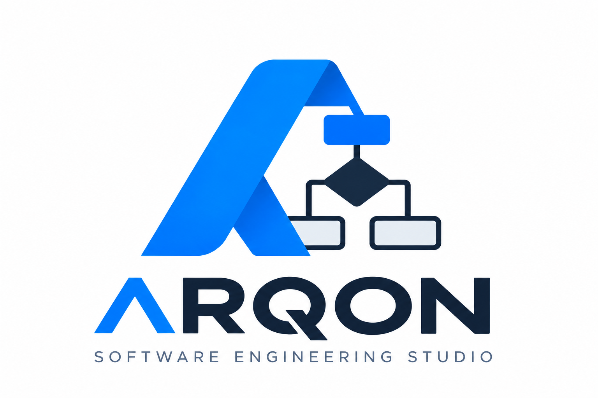

# ARQON Software Engineering Studio

<picture>
  <source media="(prefers-color-scheme: dark)" srcset="assets/branding/arqon-dark.png">
  
</picture>

Editor web para modelagem de dados, processos e sistemas em um único espaço de trabalho. O projeto reúne modelos conceituais e lógicos, fluxogramas, UML e iStar 2.0, com edição visual, propriedades semânticas, validação e arquivos de projeto locais.

O ARQON Software Engineering Studio é um projeto independente inspirado na experiência de modelagem do brModelo. Está em fase final de desenvolvimento e é preparado para publicação como código aberto. Não abre arquivos nativos do brModelo nem declara conformidade integral com UML 2.5.1.

## Comece a usar

### Desktop Tauri (Windows, Linux e macOS)

Há uma camada desktop Tauri 2 em [desktop/README.md](desktop/README.md), com arquivos locais, menu nativo e builds de CI para macOS, Windows e Linux. Os instaladores ainda precisam de validação prática em Windows e Linux antes de serem tratados como distribuição pronta. O fluxo web e o aplicativo macOS anterior continuam disponíveis.

Para o fluxo web local, são necessários um navegador moderno e Python 3. Esse fluxo funciona totalmente offline: o lançador abre um servidor apenas em `127.0.0.1`, sem enviar projetos a serviços externos. Não há instalação de dependências JavaScript nem conta de usuário.

### Aplicativo macOS

Abra `dist/ARQON Software Engineering Studio.app` com duplo clique. O aplicativo inicia o servidor Python local, abre o navegador e permanece disponível pelo ícone **▦ ARQON** na barra de menus. Escolha **Encerrar** nesse menu para parar o servidor. O pacote inclui a interface, mas usa o Python 3 instalado no macOS; não instala Python nem precisa de internet.

Para reconstruir o `.app` a partir do código, use macOS com Python 3 e o compilador Swift do Xcode Command Line Tools:

```bash
cd brmodelo-modern
python3 build_macos_app.py
```

O resultado é gravado em `dist/`, pasta ignorada pelo Git. O pacote gerado é para a arquitetura da máquina usada na compilação. Para distribuição em outra arquitetura, compile nela ou crie um binário universal.

### Lançador Python

```bash
cd brmodelo-modern
python3 brmodelo.py
```

No macOS, também é possível abrir `Abrir ARQON.command` com um duplo clique. O lançador abre [http://127.0.0.1:4173](http://127.0.0.1:4173) no navegador; feche o terminal com **Ctrl+C** para encerrar o aplicativo. Use `python3 brmodelo.py --no-browser` para iniciar sem abrir uma aba automaticamente. A porta padrão é fixa para que o navegador encontre os mesmos projetos em cada execução; alterar a porta com `--port` cria outra origem de armazenamento.

Crie um projeto, escolha um tipo de diagrama no botão **＋** e arraste elementos da biblioteca para o canvas. Use o painel de propriedades para editar os elementos e o menu **Arquivo** para salvar ou exportar.

As fontes DM Sans e Manrope são servidas pelos arquivos locais em `fonts/`; suas licenças estão na mesma pasta. A interface não depende de um serviço externo de fontes.

Os rascunhos ficam no navegador. O comando **Arquivo → Salvar** registra documentos confirmados em IndexedDB; projetos e versões de alguns módulos também usam `localStorage`. Exporte JSON para manter uma cópia transferível. Limpar os dados do navegador pode remover projetos que não foram exportados. Os links de Lattes, LinkedIn e GitHub no rodapé são opcionais e só abrem páginas externas quando clicados.

## O que o projeto oferece

| Área | Recursos principais |
| --- | --- |
| Modelo conceitual (MER) | Entidades, atributos, relacionamentos n-ários, especialização, validação, dicionário CSV e conversão inicial para modelo lógico. |
| Modelo lógico | Tabelas, colunas, chaves e relações; validação, análise de normalização, importação parcial de `CREATE TABLE` e geração local de DDL para MySQL, MariaDB, PostgreSQL e SQLite. |
| Fluxograma | Etapas, decisões, conectores, rotas editáveis, validação e avanço passo a passo pela simulação. |
| Casos de uso UML | Atores, casos de uso, limites de sistema, relações `include`/`extend`, documentação e validação. |
| Atividades UML | Nós de controle, ações, fluxos, partições, perfis, validação e exportação de imagem. |
| Classes UML | Classes, interfaces, enumerações, atributos, operações, relações e múltiplas visões sobre os mesmos classificadores. |
| Sequência UML | Linhas de vida, mensagens, ativações, fragmentos combinados, restrições e validação. |
| iStar 2.0 | Atores, objetivos, tarefas, recursos, dependências e visões SD/SR. |

A interface inclui abas, zoom, organização visual, desfazer/refazer, tema claro ou escuro, importação/exportação JSON e exemplos prontos em `exemplo-*.json`. Os formatos de exportação adicionais variam conforme o editor; consulte as seções abaixo.

## Estrutura do código

- `index.html`, `script.js` e `styles.css`: espaço de trabalho principal e editores de dados, fluxograma, casos de uso e iStar.
- `conceptual-model.mjs`, `logical-model.mjs`, `flow-model.mjs`, `use-case-model.mjs` e `istar-model.mjs`: regras e validações dos respectivos diagramas.
- `uml-activity/`, `uml-class/` e `uml-sequence/`: editores UML com modelos, validação e estilos próprios.
- `document-store.mjs`: documentos confirmados no armazenamento local.
- `tests/` e `uml-*/tests/`: testes dos modelos e regras.

Os editores UML podem ser abertos no espaço de trabalho principal ou diretamente pelos seus diretórios. Os dados e análises permanecem locais ao navegador; o projeto não conecta a um banco de dados nem executa o SQL gerado.

## Detalhes e limites dos editores

### Modelo conceitual (MER)

Diagramas antigos são normalizados ao abrir: campos que estavam dentro das entidades tornam-se nós de atributo ovais ligados à entidade, preservando nomes, identificadores e classificações conceituais. Entidades aparecem como retângulos sem lista interna de campos. O modelo semântico do MER é salvo junto do JSON exportado.

- A notação Chen é a padrão. Há uma alternância para Crow’s Foot quando o diagrama não contém entidades fracas, especializações ou atributos compostos, derivados e multivalorados que não tenham representação equivalente nessa notação.
- Relacionamentos podem ter dois ou mais participantes. Configure papéis, cardinalidades e participação em cada ponta; o botão **Adicionar participante** também permite relacionamentos recursivos com papéis distintos.
- Entidades fracas, atributos identificadores, identificadores compostos, hierarquias de atributos compostos e especializações ISA têm propriedades editáveis. Regras de negócio sem validação automática podem ser documentadas.
- A validação distingue erros e avisos. O dicionário conceitual pode ser exportado em CSV.
- A conversão cria um novo diagrama lógico e preserva o original. Entidades e chaves viram tabelas e colunas; N:N e relações n-árias viram tabelas associativas; atributos multivalorados viram tabelas separadas; compostos são decompostos; derivados são omitidos; hierarquias ISA usam tabelas de subtipo com a chave do supertipo.

Limites do MER atual: agregação conceitual ainda não está implementada; herança oferece apenas a estratégia de tabelas por subtipo; tipos SQL não são inferidos dos domínios conceituais; regras de negócio são armazenadas como documentação e não executadas; relações recursivas têm seus participantes semânticos, mas conexões coincidentes podem ficar visualmente próximas. PNG/PDF e XMI não são oferecidos pelo editor principal.

### Modelo lógico: limites atuais

- Os dados ficam no `localStorage`; não há banco conectado, execução de scripts, histórico versionado persistente ou comparação de versões.
- O formato atual salva propriedades semânticas e coordenadas no mesmo objeto de diagrama; uma mesma estrutura semântica ainda não pode ser exibida em vários layouts independentes.
- A importação SQL aceita um subconjunto de `CREATE TABLE` com colunas, PK, UNIQUE e FK. Não aceita `ALTER TABLE`, procedimentos, triggers, views nem todos os dialetos; SQL importado nunca é executado.
- A geração de SQL não declara interoperabilidade completa. Revise os tipos e recursos específicos do SGBD, sobretudo identidades, schemas e expressões CHECK/DEFAULT.
- `ON DELETE/UPDATE SET DEFAULT` é bloqueado na geração MySQL/MariaDB para evitar DDL incompatível com InnoDB; as referências oficiais confirmam a limitação para ambos ([MySQL](https://dev.mysql.com/doc/refman/8.4/en/create-table-foreign-keys.html), [MariaDB](https://mariadb.com/docs/server/ha-and-performance/optimization-and-tuning/optimization-and-indexes/foreign-keys)).
- A normalização oferece diagnósticos conservadores a partir das dependências funcionais informadas; não prova 1FN/2FN/3FN/BCNF por inferência automática.
- Ainda não há suporte completo a domínios reutilizáveis, PK/FK composta configurada manualmente no inspector, múltiplos diagramas sobre um único modelo semântico, exportação PDF/PNG ou auto-layout por dependências. A conversão conceitual → lógica já existe, mas cobre as regras descritas na seção anterior e requer revisão do resultado.

### Modelagem de Atividades UML

O item **Modelagem de Atividades UML** abre um editor separado em `uml-activity/`. O módulo usa JavaScript nativo e não altera os diagramas conceitual, lógico e fluxograma.

- Biblioteca com nós de controle, ações, nós de objeto, pins, estruturas, eventos, restrições e comentários. Arraste um item da biblioteca ou clique para adicioná-lo.
- Arraste do ponto lateral de um nó a outro para criar Control Flow ou Object Flow. Clique na linha para editar guarda, peso, sentido, tipo e roteamento. Duplo clique adiciona ponto intermediário; duplo clique em um ponto o remove.
- Use o inspetor para editar metaclasses e propriedades do tipo selecionado, associação a partições, contenção e atividade chamada. Call Behavior Action pode navegar para outra atividade do projeto.
- Partições podem ser movidas, redimensionadas, orientadas e aninhadas. Um nó pode participar de várias partições.
- Perfis e estereótipos personalizados podem ser criados, importados, exportados e aplicados. Os dez exemplos disponíveis são definidos pelo usuário; não são estereótipos nativos da UML.
- Validação separada da interface classifica erros, avisos e sugestões; clicar na ocorrência seleciona o elemento.
- Projetos e rascunhos continuam no `localStorage` para compatibilidade e recuperação imediata. O comando **Arquivo → Salvar** grava a versão confirmada em IndexedDB; os documentos confirmados podem ser reabertos na tela de projetos. Versões manuais continuam no `localStorage`.
- Exporta projeto JSON, diagrama SVG, PNG e PDF. Exporta PlantUML apenas para fluxos lineares de ações compatíveis. Importa projeto JSON e perfis JSON no formato próprio. XMI e UML Diagram Interchange não estão implementados.

O modelo semântico (`model.mjs`) é separado das coordenadas e rotas (`view`). `registry.mjs` define tipos e propriedades, `validation.mjs` implementa as regras verificadas, `storage.mjs` persiste projetos e versões, `export.mjs` gera artefatos e `layout.mjs` cuida do alinhamento. A implementação cobre um subconjunto de diagramas de atividade UML 2.5.1; estruturas compostas, perfis e Object Flow ainda não têm interpretação executável completa. A ferramenta não declara interoperabilidade UML/XMI geral nem simulação de tokens.

### Diagrama de Classes UML

O tipo **Diagrama de Classes UML** está disponível no botão **＋** da faixa de diagramas. Ele abre `uml-class/` no mesmo espaço de edição das atividades UML e mantém as abas no editor principal. Os classificadores e relações têm identidade semântica no projeto; cada diagrama guarda sua própria lista de elementos e coordenadas, permitindo compartilhar classes entre visões.

- Cria classes, classes abstratas, interfaces (retângulo ou notação lollipop), enumerações, DataTypes, PrimitiveTypes e pacotes.
- Edita atributos tipados, visibilidade, multiplicidade, valor padrão, derivação, estado estático e somente leitura. Edita operações, retorno, visibilidade, parâmetros e estados abstrato/estático.
- Cria associações, agregações compartilhadas, composições, generalizações, realizações e dependências; suas linhas distinguem traços, diamantes e triângulos. Papéis, multiplicidades e navegabilidade são editáveis nas pontas.
- Permite estereótipos textuais, perfis iniciais simples, restrições textuais, enum literals, seleção múltipla por Shift, movimentação conjunta, organizar, desfazer/refazer, rascunho local, salvar em IndexedDB, importar/exportar JSON, exportar SVG e alternar tema.
- Valida tipos e multiplicidades básicas, ciclos de herança, destino de realizações, referências e mais de um relacionamento de composição para a mesma parte.

O módulo é uma implementação parcial do metamodelo UML, não certifica conformidade completa com UML 2.5.1. Ainda não implementa associações n-árias ou classes associativas, qualificadores editáveis, herança múltipla em conjuntos de generalização, binding de templates, gerenciamento completo de pacotes/perfis/tagged values, analisador OCL, código fonte, PNG/PDF, PlantUML, Mermaid ou XMI. A geração SVG cobre o diagrama visual, mas não substitui a exportação semântica JSON. Persistência é local ao navegador. Testes: `node --test uml-class/tests/*.test.mjs`.

### Diagrama de Sequência UML

O tipo **Diagrama de Sequência UML** está disponível no botão **＋** das abas. Ele abre `uml-sequence/` no espaço compartilhado e usa as mesmas abas, estado de salvamento e armazenamento IndexedDB dos outros documentos UML.

- Modela participantes (ator, objeto, componente, sistema e interface), linhas de vida, mensagens síncronas/assíncronas/de retorno, criação, destruição, autorreferência, mensagem encontrada e perdida, ocorrências e ativações síncronas.
- Oferece fragmentos combinados com os operadores UML mais comuns, operandos e guardas, gates, restrições temporais/de duração, invariantes, anotações, referências `ref`, perfis e estereótipos com tagged values.
- Participantes e eventos podem ser reposicionados no canvas. A ordem vertical das mensagens é preservada nas ocorrências; validação verifica referências, ciclos de vida, guardas e tipos de tagged values.
- Importa e exporta JSON próprio; exporta SVG, PlantUML e Mermaid como subconjuntos gráficos. A associação a classificadores/operações lê o catálogo local do diagrama de classes.

Limites: o módulo não oferece conformidade integral com UML 2.5.1. Ainda faltam hierarquia e semântica interna dos operandos de fragmentos, execução completa de interações, avaliação temporal, edição visual de pontos de ocorrência/gates e associação validada a operações tipadas. PlantUML e Mermaid não têm importação nem interoperabilidade completa testada; XMI, PNG e PDF não estão implementados. Testes: `node --test uml-sequence/tests/*.test.mjs`.

### Diagrama de Casos de Uso UML

O tipo **Casos de Uso UML** está disponível no botão **＋** das abas e usa o canvas, a seleção múltipla, movimento, histórico, abas e salvamento local do editor principal. O modelo persiste atores, casos de uso, pontos de extensão, limite visual, relacionamentos, propriedades de extensão, documentação, estereótipos em texto, restrições e referências a diagramas UML.

- Atores usam figura UML ou retângulo `«actor»`; casos de uso são elipses; o limite do sistema tem título e dimensões ajustáveis no inspetor. O limite de apresentação fica separado do `subject` guardado no modelo.
- Cria associações ator-caso de uso, `«include»`, `«extend»` e generalizações direcionadas. A direção base/incluído e extensão/base segue a semântica UML. As conexões terminam no contorno da elipse ou do ator.
- O inspetor mantém objetivo, pré/pós-condições, garantias mínimas, gatilho, fluxo principal, alternativas, exceções, regras, requisitos, prioridade, status, estereótipos, restrições e pontos de extensão. Relações `«extend»` permitem condição e referência a ponto de extensão.
- A validação independente do canvas verifica nomes, pontas compatíveis, referências, pontos de extensão e ciclos de generalização; também relata casos de uso sem ator e documentação como aviso/sugestão. O auto-layout e a exportação JSON/SVG estão disponíveis.
- As referências a diagramas de atividades e classes são rastreabilidade textual entre documentos, sem criar relações UML não definidas.

Limites: esta é uma implementação parcial, não uma certificação de UML 2.5.1. Estereótipos são valores textuais, sem gerenciador de perfis/tagged values e sem validação por metaclasse; restrições são armazenadas, mas não avaliadas como OCL. Não há simulação, XMI, PlantUML, Mermaid, PNG/PDF, layout de swimlanes (não aplicável ao escopo de casos de uso), edição de múltiplos subjects ou redimensionamento por alças. A documentação textual é um subconjunto editável. Os dados permanecem locais no navegador. Testes: `node --test tests/use-case-model.test.mjs`.

### iStar 2.0: atores e visão híbrida

Cada ator pode ser expandido (SR) ou recolhido (SD) pelo botão junto ao círculo ou pelas propriedades. A área cresce ao inserir elementos e mantém o tamanho ao recolher. Arraste da paleta para dentro da área para atribuir o proprietário automaticamente; ao selecionar um ator, clicar na paleta acrescenta elementos a ele sem sobreposição. Durante o arraste de elementos internos, o contorno do ator cresce ou encolhe em todas as direções conforme os limites atuais dos elementos, respeitando o tamanho mínimo e as margens para mantê-los dentro da sua área. Esses elementos acompanham o movimento do ator e ficam ocultos quando ele é recolhido. O proprietário pode ser alterado explicitamente nas propriedades. Relações intencionais entre proprietários diferentes são rejeitadas. A visão individual corresponde à visão híbrida descrita na seção 7 do guia iStar 2.0.

As relações iStar permitem editar o traçado: arrastar a linha ou o ponto central ajusta a curva; dois cliques inserem um canto; arrastar um canto altera sua posição; dois cliques no canto o removem. As propriedades permitem restaurar a curva automática. O traçado é salvo no projeto, e as pontas continuam ancoradas aos símbolos ao mover os elementos.

## Testes

Na pasta `brmodelo-modern`, execute:

```bash
node --test tests/*.test.mjs uml-activity/tests/*.test.mjs uml-class/tests/*.test.mjs uml-sequence/tests/*.test.mjs
```

Os testes verificam os modelos e suas regras. Para conferir apresentação, importação, exportação e persistência, abra os editores no navegador.

## Código aberto e contribuições

A intenção é publicar o ARQON Software Engineering Studio como projeto open source após a finalização. Sugestões, relatos de problemas e contribuições serão bem-vindos quando o repositório público e suas orientações estiverem disponíveis. A licença específica deste projeto ainda deve ser definida antes da publicação.

Desenvolvido por **Erlânio Freire** · [Lattes](http://lattes.cnpq.br/8383140784249878) · [LinkedIn](https://www.linkedin.com/in/erlaniofreire) · [GitHub](https://github.com/erlanio)
